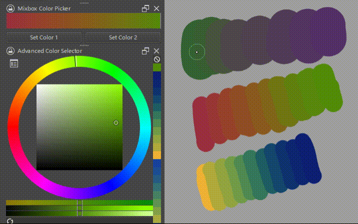

# Krita Mixbox Color Picker

Mix colors with the Mixbox algorithm for realistic paint-like blending!

## Installation

1. Put the `mixbox-color-picker.desktop` file and the `mixbox-color-picker` folder in the `pykrita` folder. See the [official guide](https://docs.krita.org/en/user_manual/python_scripting/install_custom_python_plugin.html).
2. Enable the plugin in `Settings > Configure Krita > Python Plugin Manager` and restart Krita.
3. Open the docker from `Settings > Docker > Mixbox Color Picker`.

## Usage

1. Click "Set Color 1" or "Set Color 2" to assign the current foreground color to the left/right end of the gradient.
2. Click on the gradient to pick a mixed color.

## Credits

The mixing algorithm is powered by [scrtwpns/mixbox](https://github.com/scrtwpns/mixbox).